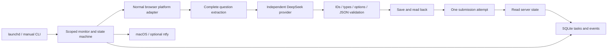

# Architecture

The live adapter and AI provider have separate clients and credential scopes. Only question IDs, types, text and options go to AI. The simulator implements the same platform-facing methods with synthetic data.

The deadline budget reserves time for saving/submission/confirmation. AI calls are batched with bounded concurrency, request timeouts and retry counts. Individually valid answers are retained; only missing/invalid questions are requested again. Optional second-pass thinking targets uncertain answers when time allows.

Before mutation, scope and identity must match. The task is persisted as SUBMITTING before the submission attempt. HTTP/network ambiguity leads to read-only reconciliation, not repeated mutation. A confirmed server completion is required for SUBMITTED.

Question extraction checks known DOM structures, explicit option identifiers, IDs and totals. Missing or ambiguous structures stop. PC list structure has prior observations; active PC exam structure and live mutation remain unverified.

The public repository includes blank config and synthetic fixtures. Local state, browser profiles and credentials stay outside source control. Packaging provides templates as wheel resources and uses a writable runtime directory.

